# CV — ChartSense computer-vision lane

An isolated computer-vision research lane. It reads candlestick chart **images**
and predicts a chart pattern plus a price direction. It is adapted from
[Harsh-617/ChartSense](https://github.com/Harsh-617/ChartSense) (MIT license,
see `LICENSE`).

**This lane never feeds the tabular LightGBM model.** Its output is a separate
research signal exposed through the dashboard's Chart Vision page.

## Architecture (how the parts fit together)

The picture below shows the whole path, from raw prices and generated chart
images on the left, to the answer shown in the dashboard on the right. Each box
is a real piece of code in this folder. Read it left to right, like a story.

```mermaid
flowchart LR
    subgraph DATA["1. Data layer - make the pictures and the labels"]
        P["Platform OHLCV parquet<br/>real prices from this project"]
        R["Random price series<br/>made by math"]
        GENOWN["make_own_dataset.py<br/>draws real 60-candle charts"]
        GENSYN["generator.py<br/>draws ideal pattern charts"]
        LABELS["labels.csv + real_labels.csv<br/>the correct answer for each picture"]
        P --> GENOWN
        R --> GENSYN
        GENOWN --> LABELS
        GENSYN --> LABELS
    end

    subgraph LOAD["2. Dataset layer - hand pictures to the model"]
        DS["dataset.py<br/>ChartDataset (synthetic)<br/>RealChartDataset (real)"]
        LABELS --> DS
    end

    subgraph MODEL["3. Model layer - the brain"]
        BACKBONE["backbone.py<br/>frozen ResNet18<br/>turns image into 512 numbers"]
        PH["heads.py - PatternHead<br/>6 chart patterns"]
        DH["heads.py - DirectionHead<br/>UP / FLAT / DOWN"]
        CS["chartsense.py<br/>ChartSenseModel joins them"]
        BACKBONE --> CS
        PH --> CS
        DH --> CS
    end

    subgraph TRAIN["4. Training layer - learn from examples"]
        S1["train.py Stage 1<br/>learn patterns on synthetic charts"]
        S2["train.py Stage 2<br/>learn direction on real charts<br/>(freeze backbone + pattern head)"]
        CKPT["best_model.pth<br/>the saved trained brain"]
        S1 --> S2 --> CKPT
    end

    subgraph SAFE["5. Fault layer - never lose work"]
        LEDGER["Ledger + atomic writes<br/>progress saved safely"]
        FP["Fingerprints + locks<br/>refuse to resume if code changed"]
    end

    subgraph SERVE["6. Serving layer - answer questions"]
        ADAPT["adapter.py<br/>analyze_chart() + get_status()"]
        INF["api/inference.py<br/>load model, softmax to probabilities"]
        API["api/cv.py<br/>/cv/health, /cv/training,<br/>/cv/evaluation, /cv/analyze"]
        GC["gradcam.py<br/>heatmap: where it looked"]
        CKPT --> INF --> ADAPT
        ADAPT --> API
        ADAPT --> GC
    end

    subgraph UI["7. Dashboard layer - what you see"]
        PAGE["Cv.jsx + cvApi.js<br/>Chart Vision page (#/cv)<br/>upload + heatmap"]
        API --> PAGE
    end

    DS --> S1
    CKPT -.->|"loaded at serving time"| INF
    SAFE -.->|"protects"| TRAIN
    DATA -.->|"labels"| TRAIN
```



In words: we make chart **pictures** and their **correct answers** (1), wrap them
so the model can read them (2), pass them through a **brain** that reads the
picture and guesses both the pattern and the direction (3), **train** that brain
in two steps (4), keep everything **safe from crashes** (5), **serve** answers
through a small web API with a heat map (6), and finally **show** it all in the
dashboard (7).

The tabular LightGBM model and the Track Q language model are **not** in this
picture on purpose. This lane is separate research.

## What it does

1. **Stage 1 — synthetic patterns.** `mplfinance` renders 3,000 idealized
   candlestick charts across six pattern classes. A frozen ImageNet ResNet18
   produces a 512-dim vector; two heads predict pattern (6 classes) and
   direction (bullish / bearish / neutral).
2. **Stage 2 — own data.** Real 60-candle images are rendered from this
   platform's `data/raw/*.parquet` files. Labels come from the platform's own
   `triple_barrier_labels` (5-session horizon, ±1σ barriers, `flat_band = 1.0`),
   so the target is exactly UP / FLAT / DOWN. The direction head is fine-tuned;
   the backbone and pattern head stay frozen.
3. **Explainability.** GradCAM highlights the image region that drove the
   pattern prediction.
4. **Serving.** `POST /cv/analyze` in the platform API accepts an uploaded
   image and returns pattern, direction, confidences and a heatmap.

Direction mapping: `bullish → UP`, `bearish → DOWN`, `neutral → FLAT`.

## Layout

```
CV/
├── chartsense/
│   ├── config.py          # absolute paths, version stamps, label maps
│   ├── adapter.py         # bridge used by the API
│   ├── api/               # inference + optional standalone app
│   ├── data/              # synthetic generator, own-data generator, datasets
│   ├── model/             # ResNet18 backbone + dual heads
│   ├── training/          # resumable stage 1/2, GradCAM, evaluation
│   ├── fault/             # atomic writes, ledger, locks, fingerprints, signals
│   └── cli.py             # all commands
├── data/                  # generated images + label CSVs (gitignored)
├── models/                # checkpoints (gitignored)
├── artifacts/             # state, ledger, logs, quarantine (gitignored)
├── evaluation/            # metrics and plots
├── templates/             # standalone app frontend
├── requirements-cv.txt
└── run_cv.ps1
```

## Setup

Install the CPU-only overlay into the repo's venv (torch is already present):

```powershell
.venv\Scripts\python.exe -m pip install --index-url https://download.pytorch.org/whl/cpu "torchvision==0.29.2+cpu"
.venv\Scripts\python.exe -m pip install -r CV/requirements-cv.txt
```

Order matters: `torchvision` first, otherwise `grad-cam` pulls a CUDA wheel.

## Commands

Run from the repo root with `.\CV\run_cv.ps1 <args>`, or from `CV/` with
`python -m chartsense.cli <args>`.

```powershell
.\CV\run_cv.ps1 status
.\CV\run_cv.ps1 doctor
.\CV\run_cv.ps1 generate-synthetic --resume --n-per-pattern 20
.\CV\run_cv.ps1 generate-own --resume --limit 3000 --symbols ADANIPORTS.NS
.\CV\run_cv.ps1 generate-all --resume
.\CV\run_cv.ps1 validate
.\CV\run_cv.ps1 audit-labels --sample 60
.\CV\run_cv.ps1 train --stage 1 --epochs 10 --resume
.\CV\run_cv.ps1 train --stage 2 --epochs 10 --lr 0.0001 --reinit-head --label-smoothing 0.05 --resume
.\CV\run_cv.ps1 evaluate
.\CV\run_cv.ps1 evaluate --no-resume
```

Stage 1 defaults to `lr=1e-3`, stage 2 to `lr=1e-4`. Extra stage-2 options:
`--reinit-head` (drop the pattern-derived direction prior), `--unfreeze-layer4`
(fine-tune the last ResNet block at `lr/10`), `--label-smoothing` (default 0).
All are part of the checkpoint fingerprint, so a changed option requires
`--no-resume`. `audit-labels` verifies each image ends at T while its label
window starts at T+1.

Stage 2 uses a chronological 80/20 split; `evaluate` scores only the future
20% holdout. A checkpoint trained with an older random split will produce
optimistic holdout numbers until it is retrained with `--no-resume`.

## Fault tolerance and resume

- Every image is written with `flush + fsync + os.replace`, then recorded in an
  append-only JSONL ledger under `artifacts/ledger/`. `labels.csv` is *derived*
  from that ledger, so a partial CSV can never destroy progress.
- Restarting any generation command with `--resume` skips valid completed
  images, regenerates corrupt ones, and continues from the last processed key.
- Every training epoch writes an atomic checkpoint with model, optimizer,
  scheduler, epoch, RNG state, best metric and fingerprints. Re-running with
  `--resume` continues at `epoch + 1`.
- `lock.py` prevents two generation or training processes from running at once;
  stale locks (dead pid or old heartbeat) are moved to quarantine.
- A fingerprint mismatch (dataset, config or code changed) **refuses** to resume
  rather than silently training on incompatible state. Use `--no-resume` to
  start fresh; old checkpoints are quarantined, not deleted.
- Ctrl+C / SIGTERM set a graceful-stop flag: the current unit finishes, state is
  saved as `paused`, and the ledger is flushed.
- `doctor` moves orphaned temp files to `artifacts/quarantine/`.
- The API starts with **no checkpoint**: `/cv/health` reports `ready: false`
  and `/cv/analyze` returns 503. A broken checkpoint is never loaded.

State files live in `artifacts/state/*.json`; progress logs in
`artifacts/logs/*.jsonl`; fsynced per-epoch metrics in `artifacts/metrics/*.jsonl`.

Each epoch appends train/validation loss, accuracy, macro F1, per-class precision /
recall / F1 / support, one-vs-rest AUC, learning rate, epoch duration, throughput
and CPU/RAM samples. Stage 2 uses inverse-frequency class weights because the
neutral class is small.

## API

- `GET /cv/health` — readiness, class lists and per-stage progress (envelope).
- `GET /cv/training` — per-stage status plus the full per-epoch metric history.
- `GET /cv/evaluation` — accuracy, AUC, confusion matrix (base64), per-class
  classification report; `ready: false` before evaluation is run.
- `POST /cv/analyze` — multipart `file`; returns
  `{signal, signal_confidence, pattern, pattern_confidence, pattern_scores,
  direction_probs, gradcam_base64, image_size, warnings}`.

The dashboard page is `#/cv`. It polls the three GET routes every 5 seconds, so
training progress, loss/accuracy curves, per-class quality, evaluation and the
upload form all update without a reload.

## Honest limitations

- Synthetic pattern accuracy (~100%) is inflated: patterns are mathematically
  injected and idealized.
- In synthetic data the direction label is derived from the pattern name, not
  from future returns. Stage 2 replaces it with real triple-barrier outcomes.
- Real direction accuracy in the original project was ~41.7% on 3 classes
  (random baseline 33.3%). This is a research signal, not a trading edge.
- Chart shape alone is insufficient; volume, sentiment and macro context matter.

See `CHART_SENSE_README.md` for the upstream README.
