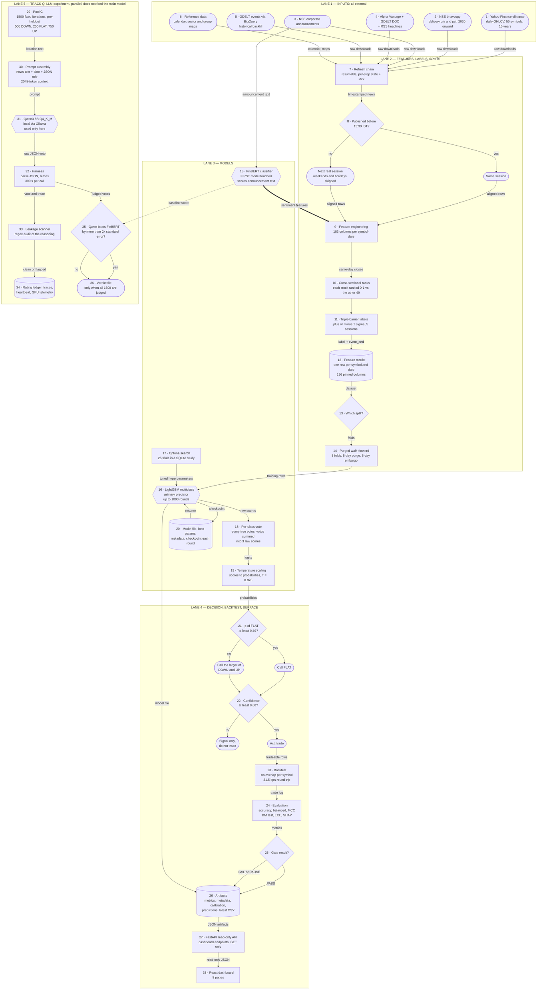

# Architecture — NSE Stock Direction Platform

One picture of the whole system: **inputs → features → labels → models → decision → surface**, with the LLM experiment as a separate lane at the bottom that never feeds the main model.

Read **top to bottom**, one lane at a time. Every node carries a number (1 → 36); `project_QA.md` §19 explains each one in plain words, and this file holds the drawing.

**Legend.** Rounded stadium = something outside this repository. Rectangle = a process step. Cylinder = something written to disk. Diamond = a fork in the road. Hexagon = a model. Thick arrow = the only model feeding the feature table. Dotted arrow = a comparison against a baseline, not a data dependency.

---

## Reading it, lane by lane

| Lane | What it settles | Detail |
| --- | --- | --- |
| 1 — INPUTS | Six external sources, nothing above them | `project_QA.md` §2 |
| 2 — FEATURES, LABELS, SPLITS | One row per symbol and date; the answer is made *before* any training | §4, and §4.2–§4.4 for the two hard parts |
| 3 — MODELS | FinBERT is met first (node 15), LightGBM predicts (node 16) | §4.5, §6 |
| 4 — DECISION, BACKTEST, SURFACE | The threshold rule, then the gate, then the artifacts and the browser | §4 (step 7), §14 |
| 5 — TRACK Q | The LLM as a **rater being measured**, not as a predictor | §8, §9, §10 |

## The five questions this picture answers

| Question | Answer | Nodes |
| --- | --- | --- |
| How does input reach the model? | Sources → one row per symbol and date → 183 columns → 136 pinned columns | 1–6 → 7 → 9 → 10 → 11 → 12 |
| Which model is touched first? | **FinBERT**, during data preparation; its output is a *feature*, not a prediction | 15 (thick arrow into 9) |
| How are votes counted? | LightGBM: every tree votes per class, votes summed into 3 raw scores. Qwen: one JSON vote per iteration | 16 → 18 → 19, and 31 → 32 |
| When is the LLM used, and for what? | Only in lane 5, only to be measured against FinBERT | 29 → 36 |
| How is a decision taken? | FLAT if p(FLAT) ≥ 0.40, otherwise the larger of DOWN and UP; trade only at ≥ 0.60 confidence. Separately, a research gate decides whether a track continues | 19 → 21 → 22, and 25 / 35 |

## What this diagram deliberately leaves out

No embeddings, chunking, vector database, RAG, retrieval, message queue, Kafka, Kubernetes, cloud storage, GPU cluster, and no second database. There is also no fine-tuned LLM anywhere on the path to node 21. The reason is in `project_QA.md` §19.5: this model reads **numbers in a fixed table**, not text passages, so there is nothing to retrieve.

One note on maintenance: the diagram exists only here. `project_QA.md` §19 holds the prose and links back to this file, so the drawing cannot drift into two versions.
